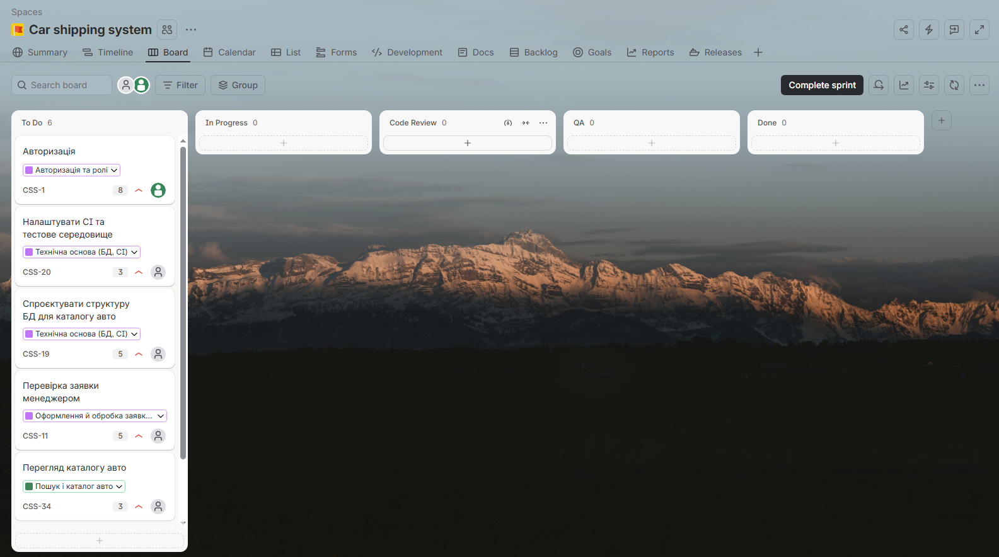
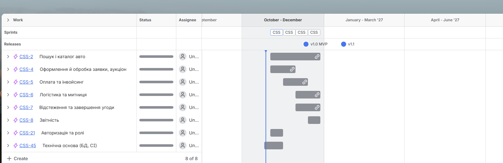
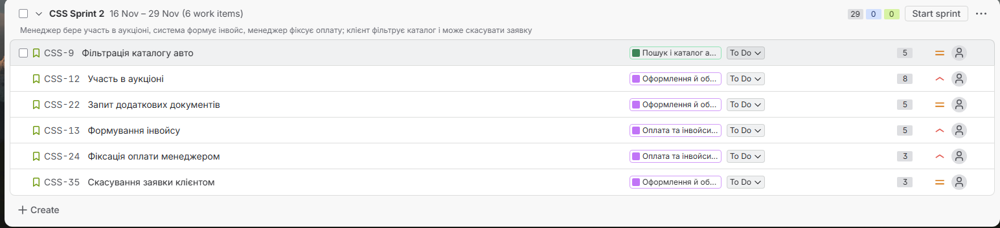
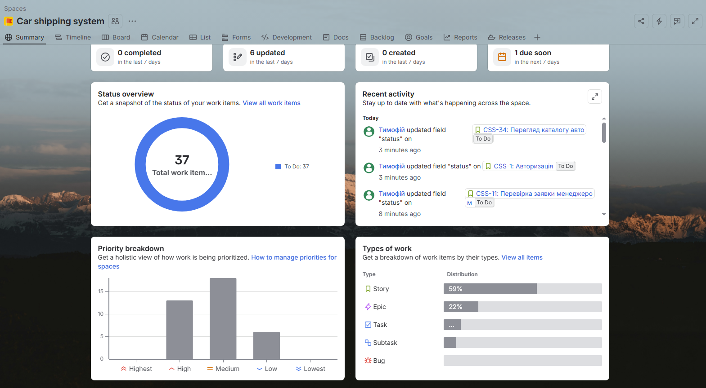
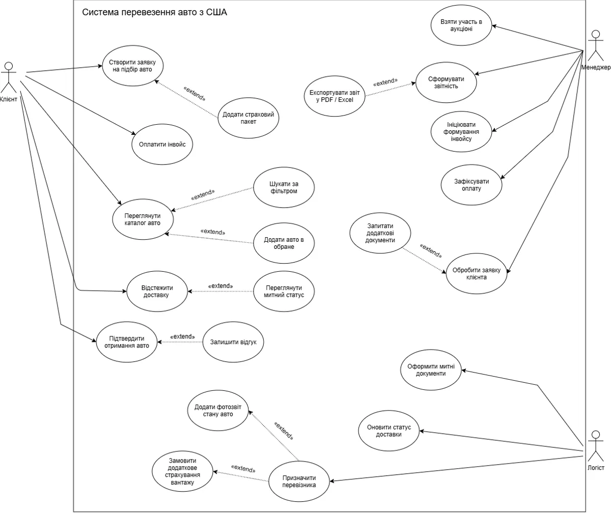
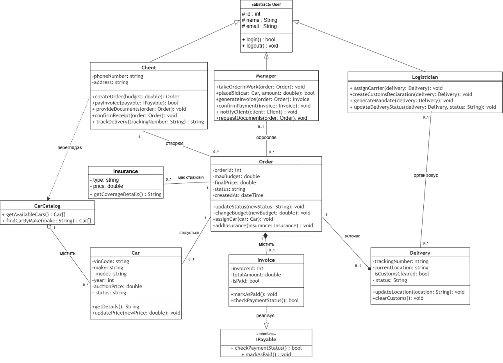
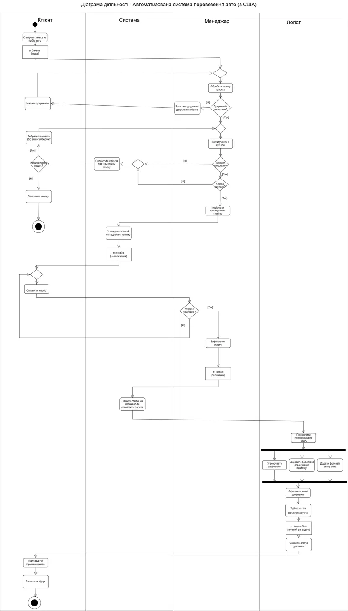
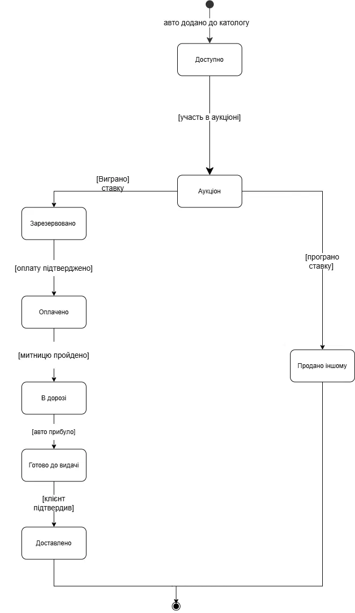

# ASTCUSA — Car Shipping System (USA)

A web application for ordering cars from US auctions and shipping them to the client. A **Client** picks a car from the catalog and creates an order, a **Manager** processes the order, bids at the auction and issues an invoice, and a **Logistician** organizes delivery and customs clearance. Each order moves through a fixed set of statuses, and each car has its own lifecycle (Available → Auction → Reserved → Paid → In transit → Ready for pickup → Delivered).

The user interface is in Ukrainian.

> The auction, payments and photo reports are simulated inside the app: a bid wins if it is at least the car's auction price, paying an invoice marks it as paid, and a photo report is a text note. There is no integration with external auction, payment or shipping services.

## Features by role

Access is controlled by role. All pages except the home page, login and registration require signing in.

### Client

- Register a new account (only clients can self-register) and sign in / sign out.
- Browse the car catalog (clients see only cars with the *Available* status) and filter it by make, model, year range and price range.
- Add cars to **Favorites** and remove them (stored in the session, cleared on logout).
- Create an order for a car with a maximum budget.
- Edit the order (change the budget or pick another car) while it is *New*, *Documents requested*, *Documents provided* or *Bid lost*. Editing a *Bid lost* order sends it back to the manager as *New*.
- Cancel an order (not possible after the bid has been won).
- Provide documents when the manager requests them.
- Add an insurance package (type and price) to an order.
- Pay an invoice.
- Track delivery: tracking number, current location, delivery status and customs status.
- Confirm receipt of the car once it is ready for pickup, then leave a review.
- See the latest notification from the manager / system on the home page.

### Manager

- Manage the car catalog: add, edit and delete cars (VIN must be unique; a car linked to orders cannot be deleted). The catalog can also be filtered by car status.
- See all orders, filter them by status.
- Take an order into work.
- Request additional documents from the client.
- Place a bid at the auction. If the car's price exceeds the client's budget, or the bid is lost, the order becomes *Bid lost* and the client is notified.
- Create an invoice after a won bid (amount = winning bid); the client is notified.
- Confirm or reject the client's payment. Rejection returns the invoice to unpaid and notifies the client; confirmation marks the order and the car as *Paid* and passes the order to logistics.
- Delete orders that are *New*, *Cancelled* or *Bid lost*.
- Build a report for a date range (orders, counts by status, number and total of paid orders) and export it as a CSV file that opens in Excel.
- Open the **DB & LINQ** section: LINQ queries over a separate database (see [Data layer and LINQ](#data-layer-and-linq)).

### Logistician

- See orders that are *Paid*, *Shipping* or *Completed*.
- Assign a carrier (creates a delivery with a tracking number).
- Generate a mandate (printable page).
- Order additional cargo insurance (with cost).
- Add a photo report (a text description of the car's condition).
- Clear customs — the order becomes *Shipping* and the car *In transit*.
- Update the delivery location and status; marking the car as arrived sets it to *Ready for pickup* and notifies the client.

## Tech stack

| Area | Technology |
|---|---|
| Framework | ASP.NET MVC 5 (5.2.9), Razor views |
| Runtime | .NET Framework 4.7.2 |
| Data access | Entity Framework 6 (6.5.1), Code First |
| Database | SQL Server LocalDB (`(localdb)\MSSQLLocalDB`): database `astcusa` (EF Code First) and a second relational database for LINQ / SQL queries |
| UI | Bootstrap 5.2.3, jQuery, jQuery Validation |
| Authentication | Forms Authentication cookie; passwords stored as PBKDF2 hashes |

The database is created automatically on first run by `ImportInitializer` (`DropCreateDatabaseIfModelChanges`), which also seeds test users and cars. If the model changes, the database is dropped and recreated.

## Data layer and LINQ

Besides the main database used by the app (EF Code First), the project has a **separate relational database** designed after the UML class diagram and used for SQL and LINQ queries.

- **6 tables**: `Users`, `Cars`, `Orders`, `Insurances`, `Invoices`, `Deliveries`; 7 foreign keys, unique and check constraints, 12-26 seeded rows per table.
- Created by an idempotent T-SQL script. The site runs it automatically on the first visit to the **DB & LINQ** page if the database does not exist.
- Accessed through a second `DbContext` with its own connection string in `CSS/Web.config`, independent from the main one.
- The **DB & LINQ** page is available to the Manager only.

| # | Query | Demonstrates |
|---|---|---|
| 1 | Cars filtered by make, year range and price | Filtering, sorting |
| 2 | Client orders by e-mail and status | Filtering, joins, left join |
| 3 | Sum and count of paid invoices for a day, month or half-year chosen by the user | Aggregation (`Sum`, `Count`) over a period |
| 4 | Deliveries by status and customs state | Filtering, join of five tables |
| 5 | Orders grouped by status or car make | `group by`, `Count`, `Average`, `Min`, `Max` |
| 6 | Insurances: add, edit, delete | INSERT / UPDATE / DELETE via LINQ (POST + anti-forgery token) |

## Getting started

Requirements: Visual Studio with the **ASP.NET and web development** workload (includes IIS Express and SQL Server LocalDB) and the .NET Framework 4.7.2 targeting pack.

1. Open `CSS.slnx` in Visual Studio.
2. Press **F5**. NuGet packages are restored on build.
3. The site opens at **https://localhost:44392**.

The connection strings are in `CSS/Web.config`. The second database is created automatically on the first visit to the **DB & LINQ** page (sign in as the manager).

## Test accounts

Seeded by `CSS/Models/ImportInitializer.cs`:

| Role | Name | Email | Password |
|---|---|---|---|
| Client | Іван Петренко | `ivan@mail.com` | `Ivan#2026` |
| Client | Марія Шевчук | `maria@mail.com` | `Maria#2026` |
| Manager | Олена Коваль | `manager@mail.com` | `Manager#2026` |
| Logistician | Андрій Мельник | `logist@mail.com` | `Logist#2026` |

Six cars are also seeded (Toyota Camry, Honda Civic, Ford Mustang, Tesla Model 3, BMW 328i, Toyota Prius), all *Available*.

## Project structure

```
CSS.slnx                     Solution file
docs/diagrams/               UML diagrams (see below)
CSS/                         Web project (ASTCUSA.csproj)
├── App_Start/               Bundles, global filters ([Authorize]), routes
├── Controllers/
│   ├── BaseController.cs    Current user/role, AllowRoles attribute
│   ├── AccountController.cs Login, registration, logout
│   ├── HomeController.cs    Home page / role dashboard
│   ├── CarsController.cs    Catalog, search, favorites, car CRUD
│   ├── OrdersController.cs  Order workflow for all three roles
│   └── ReportsController.cs Reports and CSV export
├── Models/
│   ├── User.cs              Abstract User + Client, Manager, Logistician (TPH)
│   ├── Car.cs, CarCatalog.cs
│   ├── Order.cs, Insurance.cs, Invoice.cs (IPayable), Delivery.cs
│   ├── OrderReport.cs       Report data and CSV generation
│   ├── Enums.cs             CarStatus, OrderStatus, UserRole
│   ├── ImportContext.cs     EF DbContext
│   ├── ImportInitializer.cs DB initializer and seed data
│   ├── AuthTicket.cs, PasswordHasher.cs
│   └── AccountViewModels.cs
├── Views/                   Razor views: Account, Cars, Home, Orders, Reports, Shared
├── Content/, Scripts/       CSS and JS (Bootstrap, jQuery)
└── Web.config               Connection string and app settings
```

## Project management

The project is planned and tracked in **Jira** and documented in **Confluence**.
- Full Confluence export (PDF): [CSS-Confluence-export.pdf](docs/confluence/CSS-Confluence-export.pdf)

### Jira









## Diagrams

The code follows the UML diagrams in `docs/diagrams`.

### Use case diagram



> The diagram mentions exporting the report to PDF / Excel; the implementation exports CSV, which opens in Excel.

### Class diagram



### Activity diagram



### Car state diagram


