# ASTCUSA — Car Shipping System (USA)

A web application for ordering cars from US auctions and shipping them to the client. A **Client** picks a car from the catalog and creates an order, a **Manager** processes the order, bids at the auction and issues an invoice, and a **Logistician** organizes delivery and customs clearance. Each order moves through a fixed set of statuses, and each car has its own lifecycle (Available → Auction → Reserved → Paid → In transit → Ready for pickup → Delivered).

The user interface is in Ukrainian.

> The app is not connected to external auction, payment or shipping services. The manager bids on the auction site (Copart, IAAI, Manheim) and records the bid in the app: lot number, lot link, amount and result. Paying an invoice marks it as paid, and a photo report is a text note.

## Highlights

- **Full business workflow for three roles**: 12 order statuses and 8 car statuses, with the rules for each transition kept in the domain model (`CSS/Models`), not in the views.
- **Auction bidding**: bids within the client's budget, each new bid higher than the last one including the other bidder's, results won / lost / outbid, and a history of all bids.
- **Data integrity**: one `SaveChanges` (one transaction) per action, unique indexes, and `RowVersion` checks so two users cannot overwrite each other or order the same car.
- **Security**: PBKDF2 password hashes, role-based access on every action, anti-forgery tokens on all POST forms, uploaded files checked by their content (a renamed HTML file is not accepted as a PDF).
- **Reporting**: orders for a date range with totals by status, exported to CSV for Excel.
- **Unit tests** for the auction rules and file upload checks (`CSS.Tests`, MSTest).
- **Project management**: planned in Jira, documented in Confluence (charter, WBS, risks, SRS, UAT, release notes), with UML diagrams that match the code.

## Screenshots

| | |
|---|---|
| 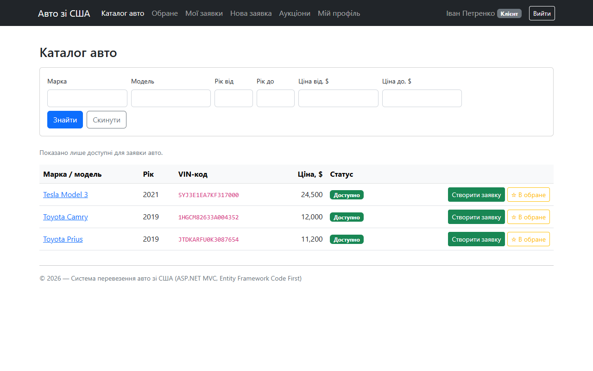 Car catalog with filters (client) | 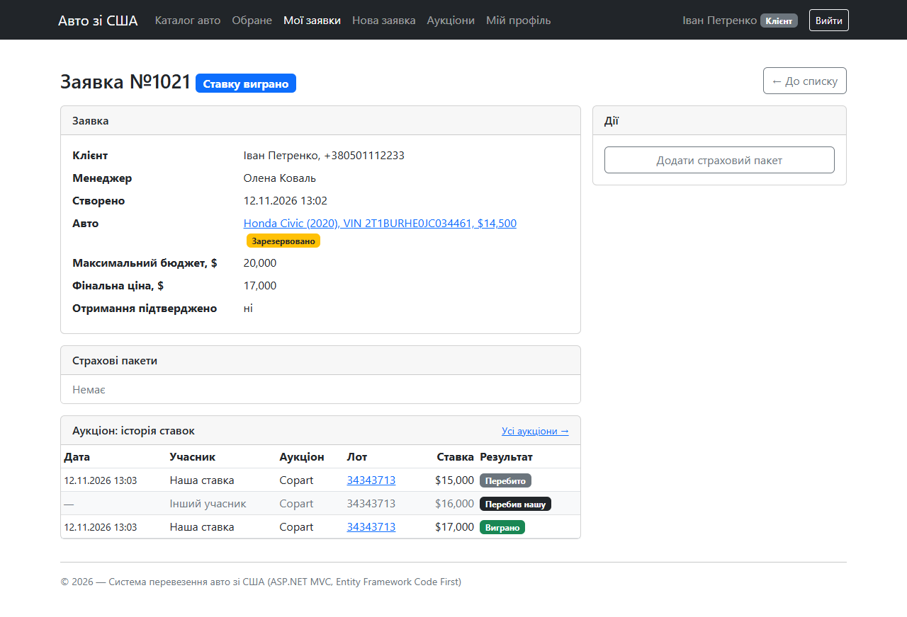 Order with its auction bids (client) |
| 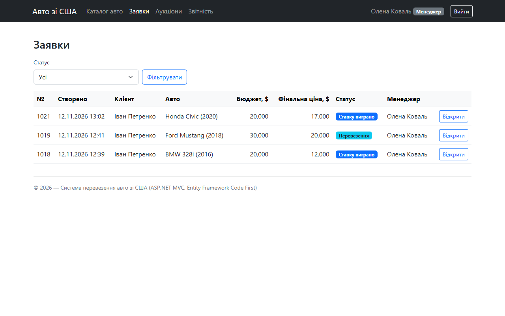 All orders by status (manager) | 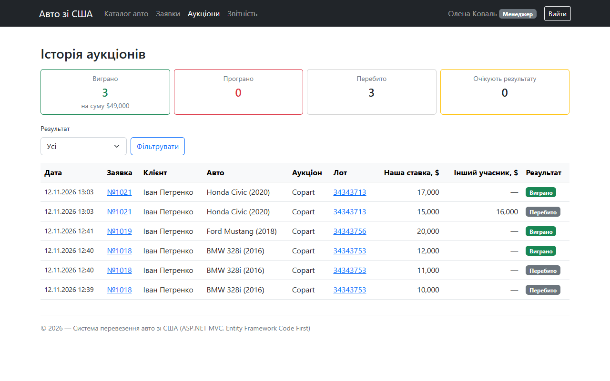 Auction history with results (manager) |
| 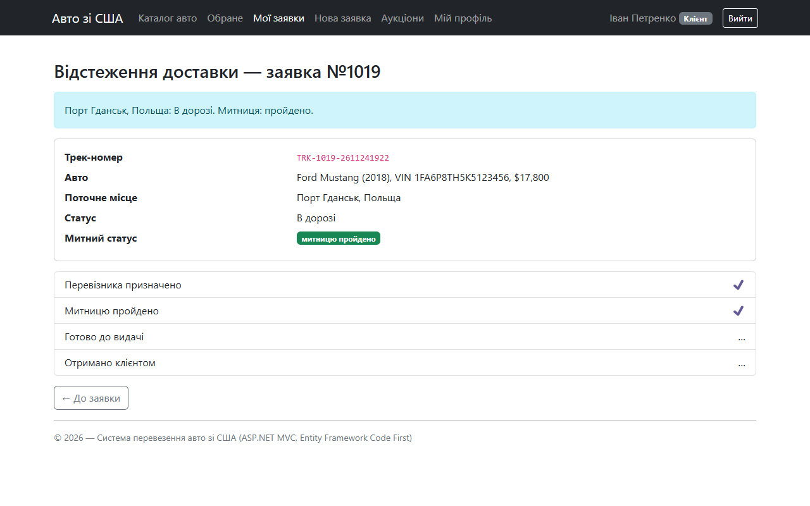 Delivery tracking (client) | 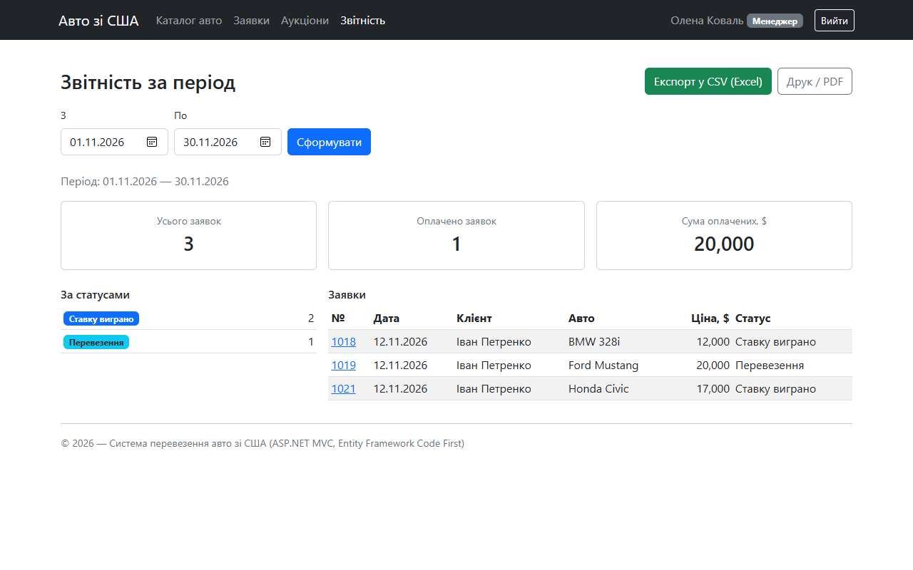 Report for a period with CSV export (manager) |

## Features by role

Access is controlled by role. All pages except the home page, login and registration require signing in.

### Client

- Register a new account (only clients can self-register) and sign in / sign out.
- View and edit the profile (name, phone, address); delete the account if it has no orders.
- Browse the car catalog (clients see only cars with the *Available* status) and filter it by make, model, year range and price range.
- Add cars to **Favorites** and remove them (stored in the session, cleared on logout).
- Create an order for a car with a maximum budget.
- Edit the order (change the budget or pick another car) while it is *New*, *Documents requested*, *Documents provided* or *Bid lost*. Editing a *Bid lost* order sends it back to the manager as *New*.
- Cancel an order (not possible after the bid has been won).
- Provide documents when the manager requests them: attach up to 10 files (PDF, JPG, PNG, up to 5 MB each). The file type is checked by its content, not only by its extension.
- See the auction history of their orders: every bid with the auction, lot link, amount, result and the other bidder's amount when the bid was outbid or lost.
- Add an insurance package (type and price) to an order, change or remove it until the order is paid.
- Pay an invoice.
- Track delivery: tracking number, current location, delivery status and customs status.
- Confirm receipt of the car once it is ready for pickup, then leave a review.
- See the latest notification from the manager / system on the home page.

### Manager

- Manage the car catalog: add, edit and delete cars (VIN must be unique; a car linked to orders cannot be deleted). The catalog can also be filtered by car status.
- See all orders, filter them by status.
- Take an order into work.
- Request additional documents from the client.
- Request additional documents again if the provided ones do not fit, and open the attached files.
- Take part in the auction. If the car's price exceeds the client's budget, the order becomes *Bid lost* and the client is notified. Otherwise the manager records the bid (auction, lot number, lot link, amount, within the client's budget) and the car becomes *Auction*.
- Set the bid result:
  - *Outbid*: the other bidder's amount is recorded, the car is *Available* again and the manager can place a higher bid;
  - *Won*: the car becomes *Reserved*, the order *Bid won*, and the client is notified;
  - *Lost*: the car becomes *Sold to other*, the order *Bid lost*, and the client is notified.
- Edit or remove a bid while it is waiting for the result. Bids with a result stay in the history.
- See the auction history of all orders, filtered by result, with the number and total of won bids.
- Create an invoice after a won bid (amount = winning bid); the client is notified.
- Confirm or reject the client's payment. Rejection returns the invoice to unpaid and notifies the client; confirmation marks the order and the car as *Paid* and passes the order to logistics.
- Delete orders that are *New*, *Cancelled* or *Bid lost* and have no auction bids.
- Build a report for a date range (orders, counts by status, number and total of paid orders) and export it as a CSV file that opens in Excel.

### Logistician

- See orders that are *Paid*, *Shipping* or *Completed*.
- Assign a carrier (creates a delivery with a tracking number).
- Generate a mandate (printable page).
- Order additional cargo insurance (with cost).
- Add a photo report (a text description of the car's condition).
- Clear customs — the order becomes *Shipping* and the car *In transit*.
- Update the delivery location and status; marking the car as arrived sets it to *Ready for pickup* and notifies the client.

## Tech stack

| Area | Technology |
|---|---|
| Framework | ASP.NET MVC 5 (5.2.9), Razor views |
| Runtime | .NET Framework 4.7.2 |
| Data access | Entity Framework 6 (6.5.1), Code First |
| Database | SQL Server LocalDB (`(localdb)\MSSQLLocalDB`): database `astcusa` (EF Code First) |
| UI | Bootstrap 5.2.3, jQuery, jQuery Validation |
| Authentication | Forms Authentication cookie; passwords stored as PBKDF2 hashes |

The database schema is managed by **EF6 Code First Migrations** (`CSS/Migrations`). On startup `ImportInitializer` (`MigrateDatabaseToLatestVersion`) creates the database if it is missing and applies new migrations without deleting data; test users and cars are seeded only into an empty database.

### Data integrity and concurrency

- Every action saves all its changes with one `SaveChanges`, which EF runs in a single transaction: changes to several tables (order, car, invoice, notification) are saved together or not at all.
- Unique indexes on user e-mail, car VIN and invoice order; foreign keys; validation attributes on the models.
- `Car` and `Order` have a `RowVersion` concurrency token. Editing a car or an order that someone else changed after the form was opened is rejected with a message, and two clients cannot order the same car at the same time.

## Getting started

Requirements: Visual Studio with the **ASP.NET and web development** workload (includes IIS Express and SQL Server LocalDB) and the .NET Framework 4.7.2 targeting pack.

1. Open `CSS.slnx` in Visual Studio.
2. Press **F5**. NuGet packages are restored on build.
3. The site opens at **https://localhost:44392**.

The connection string is in `CSS/Web.config`. The database is created and filled with test data on the first start.

### Unit tests

`CSS.Tests` (MSTest) checks the domain rules without a database: placing bids within the budget, outbid and won results, lot link validation, uploaded file type checks and phone number format. Run them in Visual Studio from **Test → Run All Tests** (Test Explorer).

## Test accounts

Seeded by `CSS/Models/ImportInitializer.cs`:

| Role | Name | Email | Password |
|---|---|---|---|
| Client | Іван Петренко | `ivan@mail.com` | `Ivan#2026` |
| Client | Марія Шевчук | `maria@mail.com` | `Maria#2026` |
| Manager | Олена Коваль | `manager@mail.com` | `Manager#2026` |
| Logistician | Андрій Мельник | `logist@mail.com` | `Logist#2026` |

Six cars are also seeded (Toyota Camry, Honda Civic, Ford Mustang, Tesla Model 3, BMW 328i, Toyota Prius), all *Available*.

## Project structure

```
CSS.slnx                     Solution file
CSS.Tests/                   Unit tests of the domain model (MSTest)
docs/
├── diagrams/                UML diagrams (see below)
├── images/                  App and Jira screenshots
└── confluence/              Confluence export (PDF)
CSS/                         Web project (ASTCUSA.csproj)
├── App_Start/               Bundles, global filters ([Authorize]), routes
├── Controllers/
│   ├── BaseController.cs    Current user/role, AllowRoles attribute
│   ├── AccountController.cs Login, registration, logout
│   ├── HomeController.cs    Home page / role dashboard
│   ├── CarsController.cs    Catalog, search, favorites, car CRUD
│   ├── OrdersController.cs  Order workflow for all three roles, auction bids and history
│   ├── ProfileController.cs Client profile: view, edit, delete
│   └── ReportsController.cs Reports and CSV export
├── Migrations/              EF6 Code First migrations and their configuration
├── Models/
│   ├── User.cs              Abstract User + Client, Manager, Logistician (TPH)
│   ├── Car.cs, CarCatalog.cs
│   ├── Order.cs, Insurance.cs, Invoice.cs (IPayable), Delivery.cs
│   ├── AuctionBid.cs        Auction bid (lot, link, amount, result) and BidResult
│   ├── OrderDocument.cs     Files attached to an order, type checked by signature
│   ├── PhoneNumbers.cs      Ukrainian phone number check and format
│   ├── OrderReport.cs       Report data and CSV generation
│   ├── Enums.cs             CarStatus, OrderStatus, UserRole
│   ├── ImportContext.cs     EF DbContext
│   ├── ImportInitializer.cs Migrating DB initializer and seed data
│   ├── AuthTicket.cs, PasswordHasher.cs
│   └── AccountViewModels.cs
├── Views/                   Razor views: Account, Cars, Home, Orders, Reports, Shared
├── Content/, Scripts/       CSS and JS (Bootstrap, jQuery)
└── Web.config               Connection string and app settings
```

## Project management

The project is planned and tracked in **Jira** and documented in **Confluence**.
- Full Confluence export (PDF): [CSS-Confluence-export.pdf](docs/confluence/CSS-Confluence-export.pdf)
- Project documents by topic (charter, WBS, RACI, risks, UAT and others): see the [documentation index](docs/README.md)

### Jira

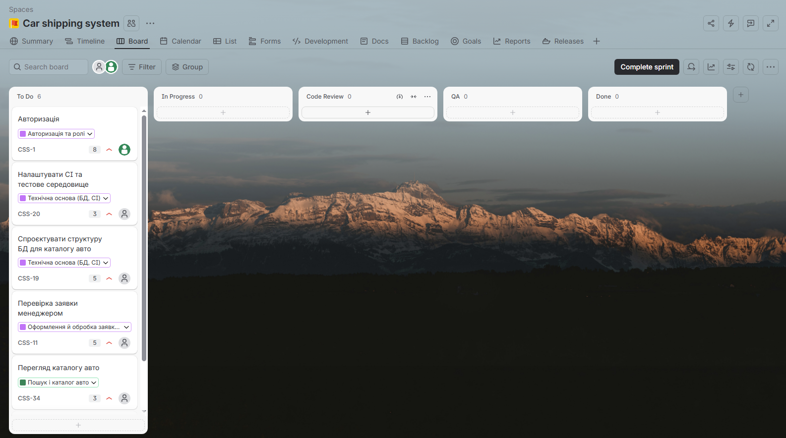

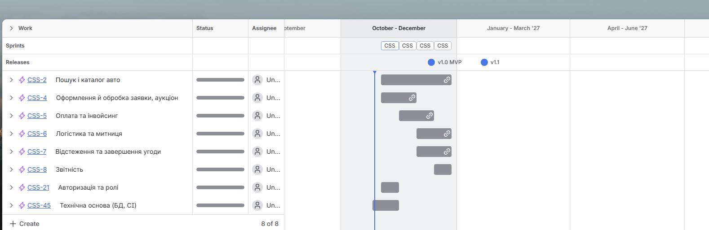

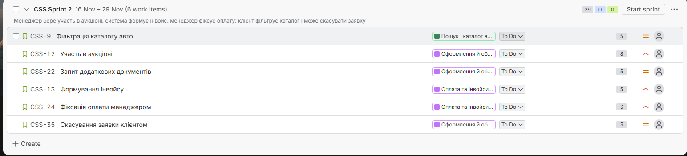

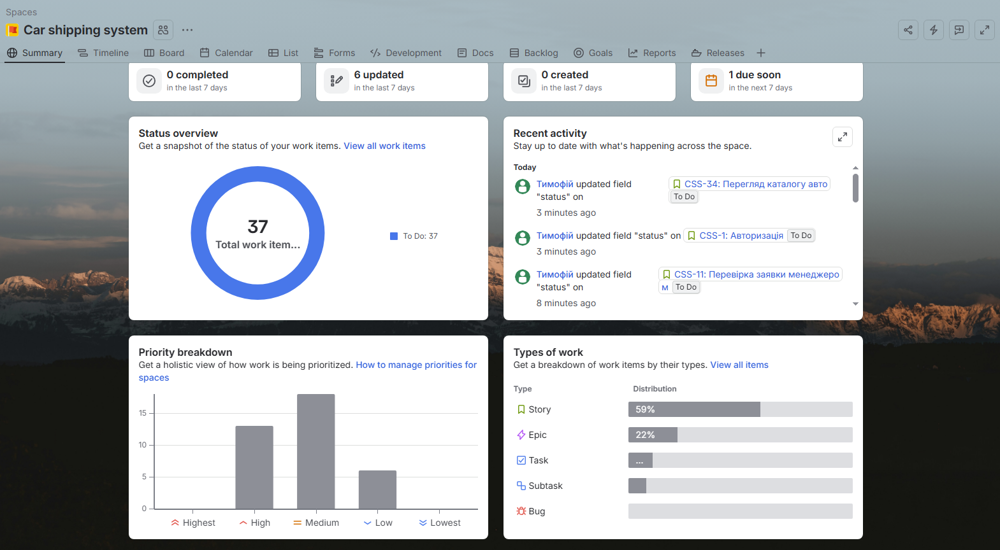

## Diagrams

The UML diagrams in `docs/diagrams` match the code and each other:

- actions of the client, manager and logistician on the activity diagram are use cases of that actor on the use case diagram;
- states on the car state diagram are the values of `CarStatus`, and its transitions are named after the use cases that cause them;
- classes, members and enumerations on the class diagram are taken from `CSS/Models`.

Each PNG contains the diagram source, so it opens for editing in draw.io (diagrams.net).

### Use case diagram

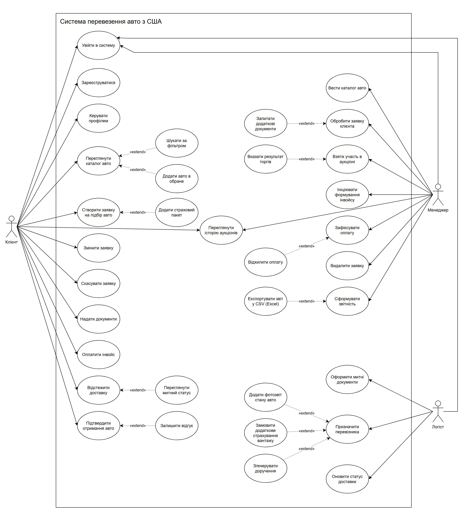

### Class diagram

The domain model (`CSS/Models`). Navigation properties and foreign keys are shown as associations; controllers and view models are not shown.

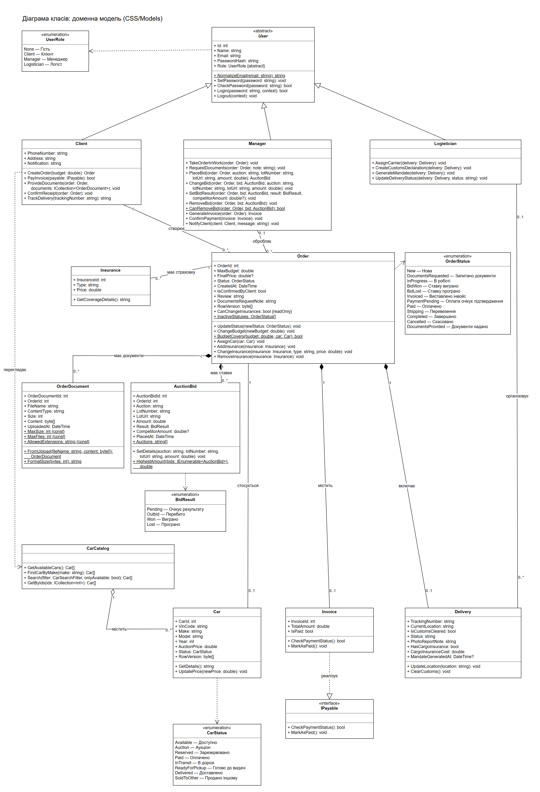

### Activity diagram

The order workflow. The «Система» lane shows what the application does automatically: status changes, the invoice, the tracking number and client notifications.

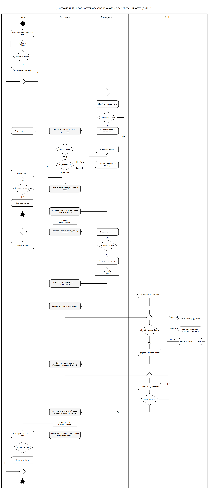

### Car state diagram

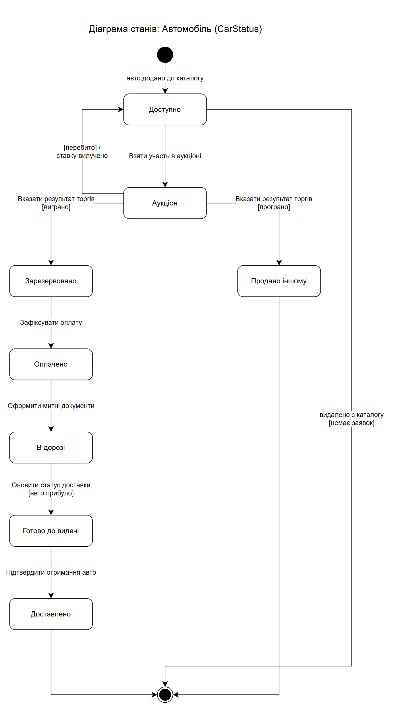
